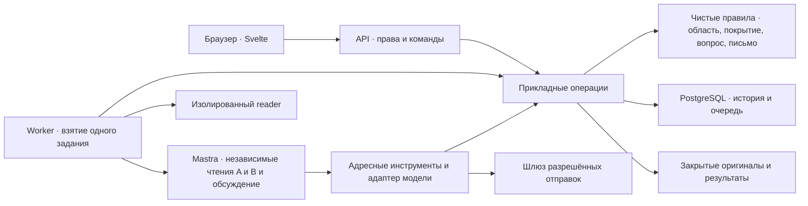

# Техническая спецификация Facade AI · редакция 0.7

Редакция 0.19 сохраняет самостоятельные чтения, продолжает незавершённый вопрос на его собственных оригиналах и разрешает расхождение в выборе решающих цитат через проверку пары значений. [Контракт и проверка на Wafer US](reader-continuation.md)

В профиле 0.18 для запроса о непередаче проверяются предмет и адресное свидетельство по текущей поставке. Маршрут Kimi на синтетическом тесте — Relace FP4 с обязательным ZDR. [Правило, испытание и настройки](delivery-proof.md)

**Предлагаемый стек.** Самостоятельный веб-продукт на TypeScript/Node.js с Svelte, PostgreSQL и закрытым объектным хранилищем. Mastra исполняет исследования по листу и адресные проверки. В одной рабочей сессии возможны несколько обращений к модели и инструментам. Публичное API и фоновые обработчики выпускаются одной версией из одного репозитория. Система начинает с пустой БД, собственного каталога, новых оригиналов и собственных адаптеров. Разбор альтернатив и условия выбора Rust зафиксированы в [независимом ревью](design-review.md).

**Условный ведущий в профиле 0.17.** После фиксации двух независимых чтений переключатель применяется к отдельному инженерному вопросу. Входом ведущего служат обе позиции и исходные материалы, уже открытые в этих ветвях. Участники сверяют предлагаемое решение по тем же адресам. Первичные свидетельства и поздние проверки сохраняются отдельными версиями. [Переходы, удержания и реализация harness](conditional-review.md)

## Чистая архитектура и размещение

Стрелки показывают вызовы при исполнении. В исходниках интерфейсы задаёт прикладной пакет. Домен принимает значения и возвращает решения, без SDK, SQL, конвертеров и часов процесса. Время, права, версии и разрешённые места передаёт вызывающий код.

| Место в репозитории | Ответственность |
|---|---|
| `packages/domain` | Типизированные значения и единицы, совместимость областей, покрытие частей, состояния вопросов, пригодность пункта и состав письма. Один набор правил для UI, API и экспорта |
| `packages/application` | Проверить права и версии, разрешить места, принять оригинал, записать результат исследования/проверки, применить решение инженера, сохранить черновик, зафиксировать внешнюю отправку |
| `packages/adapters` | SQL и транзакции, объекты, получение ограниченного представления для читателей, реестр внешних операций, экспорт TXT/DOCX. Единственный модуль сетевого выхода к модели — шлюз с отдельной учётной записью |
| `apps/api`, `apps/worker`, `apps/web` | Публичный HTTP (предлагается Fastify), обработка заданий, рабочее место инженера. API и worker используют одну прикладную библиотеку, права выдаются отдельно |
| `packages/research` | Версионированные определения workflow Mastra, обзор листа, выбор последующих чтений, слепое обследование и независимые вердикты. Результат пересекает схему и семантическую проверку прежде, чем влияет на проект |
| `contracts`, `catalog`, `fixtures` | Версионированные форматы обмена, правила и шаблоны нового продукта, синтетические материалы и независимая разметка |

Для первого стенда достаточно PostgreSQL, закрытого тома для объектов, API и worker; конвертеры запускаются в изолированном процессе. Разделение прав на платную сеть обеспечивается доверенным процессом шлюза из той же сборки. Для локальной проверки его транспорт подставной. Отдельные брокер, векторная база и сервер для каждого агентного задания не требуются.

## Как агент работает на VPS без Codex

Контракт исполнения, аргументы инструментов, обработка частичных ответов и ход по разным форматам определены в [спецификации harness](vps-harness.md). Состав визуального входа проверяется на последней границе сериализации. Для каждого предъявленного материала адаптер сохраняет [квитанцию](../contracts/model-input-receipt.v1.schema.json). Для inline-изображения хэш считают по декодированным байтам, для файла провайдера сверяют подтверждённую неизменяемую загрузку с её хэшем, для текста — по предъявленному тексту в UTF-8. По идентификаторам восстанавливаются страница или представление, преобразование координат, родительский рендер и номер части запроса. Исход сетевой попытки и последующее прочтение учитываются отдельно. Если SDK скрывает финальный запрос, профиль проходит через наблюдаемый транспорт или получает статус «визуальная доставка не подтверждена».

На VPS запускаются API, Node.js worker с Mastra, изолированный Linux-процесс чтения, PostgreSQL и закрытое хранилище документов и производных. API и worker можно поставить из одного образа приложения с разными точками входа. При использовании внешней модели вычисления модели выполняет её провайдер. Для самостоятельно размещённой модели нужен отдельно выбранный сервер инференса; требования к нему определяются самой моделью. Предметный harness — часть worker и прикладной библиотеки в этом репозитории. Это код, который собирает доступный агенту контекст, предоставляет инструменты, выполняет выбранные действия и возвращает результаты в следующий ход.

| Что в пилоте обеспечил Codex вместе с рецензентами и ведущим | Кто делает это в продукте |
|---|---|
| Прочитать задание, применить правила проекта, выбрать следующий фрагмент | Worker собирает версионированное поручение по этапу и области, перечень обязательных проверок, доступные места и уже полученные сведения своей ветви. Модель выбирает содержательное действие. Запись об активных ограничениях переживает сокращение контекста |
| Найти файл, вызвать программы, написать разовый скрипт, открыть отрисовку и увеличить её | Предметные инструменты reader: опись и список физических страниц/листов, общий вид и области изображения, нативный текст с координатами, OCR участка, таблица с заголовками, CAD-layout, блок, объект по handle и его видимое окружение. Возвращаются адрес, редакция, реальный результат и пределы чтения. Для используемых форматов, шрифтов и утилит поставляются закреплённые Linux-версии. В базовом профиле модель вызывает зарегистрированные операции; произвольный shell и доступ ко всей файловой системе ей не выдаются |
| Запустить два отдельных чтения, сохранить их до обмена, попросить оппонента открыть конкретное место | ReceiptProcess выдаёт A/B независимые назначения. Worker использует Mastra для вызова агента и инструментов. После фиксации двух исходных версий приложение открывает DiscussionRevision по общему срезу. Находки, возражения, повторные открытия и незакрытые обязанности имеют отдельные записи |
| Напомнить передать находку, восстановить ход и собрать ответ для инженера | Прикладной обработчик сохраняет результаты ходов, ставит верификацию даже без команды публикации от модели, подхватывает незавершённые переходы. Домен строит матрицу комплектности. Инженер принимает решение через UI |

**Один реальный ход.** Worker передаёт ветви общий вид листа и схему инструмента увеличения. Модель запрашивает участок в координатах этого листа. Worker проверяет проект, редакцию, ветвь и допустимые размеры. Reader рендерит исходник и возвращает изображение участка с единицей измерения в заголовке. Адаптер предъявляет модели **пиксели** в поддерживаемом ею формате; один идентификатор картинки не даёт модели возможности её увидеть. Если API не принимает картинку непосредственно в результате инструмента, worker формирует следующий допустимый мультимодальный вход и сохраняет ту же связь с местом. Модель может запросить соседнюю область, сообщить факт с адресом или явно оставить вопрос. Если доступные инструменты не позволяют осмотреть нужное представление, процесс фиксирует ограничение и показывает его инженеру. Сигнал для разработки — повторяющиеся случаи, в которых рецензент в Codex смог прочитать оригинал только при помощи незапланированного скрипта.

**Граница SDK.** Для первого исполнения достаточны шаги workflow, вызов агента и регистрация инструментов в Mastra. Нужные возможности восстановления SDK можно подключать по отдельности. Очередь, допуск внешней отправки, сохранённое доказательство и авторское решение остаются у уже определённых владельцев. Внешний запрос проходит через шлюз проекта. В цикле с инструментами одно обращение к SDK может повлечь несколько обращений к провайдеру: каждый фактический ход получает собственную квитанцию, а повтор по неясному исходу удерживается. [Агенты и инструменты в workflow](https://mastra.ai/docs/workflows/agents-and-tools) · [Возможности Mastra Harness](https://mastra.ai/docs/harness/overview)

**Профиль адаптера модели.** Для A и B отдельно закрепляются провайдер, фактическая модель и доступная редакция, системное поручение, формат визуального ввода, размер изображения и контекста, способ выбора инструмента и разбора результата. На контрольной таблице проверяются доставка пикселей, выбор участка, повторное открытие, сохранение чисел/единиц и связь результата с реально выданным адресом. Если провайдер поддерживает только текст, такой профиль можно квалифицировать для текстовых задач; самостоятельное визуальное чтение сложного листа остаётся неподтверждённым. Смена провайдера, разрешения, модели, настроек рассуждения или reader создаёт новый профиль оценки. При недоступной версии провайдера фиксируют доступную идентичность и дату прогона, а вывод о воспроизводимости ограничивают этим срезом. [Испытание переносимости](qualification.md#перенос-из-пилота-codex-на-vps)

## Состояние и запись

| Объекты | Владелец | Транзакционная граница и восстановление |
|---|---|---|
| Project, Membership, CatalogRevision | Проекты | Права по проекту. Новая редакция профиля и решение применить её записываются отдельно, с перечнем затронутых позиций |
| Upload, Receipt, InventoryEntry, DocumentRevision | Приём | Подтверждение всех частей загрузки, длины и хэша; финализация привязывает оригинал и создаёт работу по описи. Вложение/дубль сохраняет свою строку с родителем. Одинаковые байты в разных проектах не дают общих прав |
| Reading, Locator | Источники | Оригинал, хэш, версия reader и профиль. Карта прочитанных и пропущенных страниц/листов. Для PDF — физическая страница, поворот, рамка и система координат; CAD — вид/объект; таблица — заголовок, строка и столбец; текст — абзац и отпечаток |
| SourceUnit, CoverageObligation, Limitation | Источники и комплектность | Единицы оригинала и обязанности учитываются до появления находок. Ограничение хранит затронутые единицы и обязанности либо явно неизвестное влияние. Открытое ограничение удерживает отрицательный вывод и полноту потенциально связанной области, сохраняя доступ к проверенным независимым результатам |
| ResearchSession, PageSurvey, TurnReceipt, ResearchIntent, Candidate, DiscussionRevision, Review, AppliedClaim | Исследование и применение | Сессия закреплена за редакциями и предметом. У каждого хода есть исход. Обзор физического листа и исходы его отдельных находок сохраняются самостоятельно. Кандидат и постановка проверки — одна транзакция. Вердикт и его решение об актуальности, изменение проектной версии и зависимой проекции — одна прикладная операция |
| Coverage, Issue, AssessmentRevision, EngineerDecision, EngineerConclusion | Комплектность | Отдельные записи для машинного результата, ручного решения и его отмены. Стойкая идентичность вопроса включает проект, предмет, часть, область, причину. Версия состояния содержит основания и зависимые неопределённости |
| Preview, DraftRevision, SentSnapshot, Reply | Письма | Состав, адресат, объём рассмотрения, версия проекта и шаблона определяют предпросмотр. Черновик получает номер при первом содержательном сохранении. Снимок связывает точный отправленный текст с его составом и датой |
| ReceiptProcess, WorkItem, CommandReceipt, ModelAttempt | Выполнение | Запись очереди в той же БД и транзакции, что породивший её факт. Уникальный work key, аренда и монотонный fencing token; команды с ожидаемой версией и квитанцией. Деньги — десятичное значение с валютой |

Оригинал проходит временную загрузку, проверку размера и контрольной суммы, фиксацию неизменяемого объекта, затем транзакцию его привязки. До привязки объект недоступен пользователям. На upload выделяется свой ключ объекта. Запись staging меняет состояние ready → bound в транзакции привязки либо ready → collecting по истечении аренды. Сборщик может удалить только захваченный collecting объект. Он не конкурирует с привязкой, у нового повтора после сбора будет новый ключ. Браузер сохраняет commandId до вызова финализации. После обрыва повтор финализации возвращает существующую квитанцию; сборка мусора проверяет ссылки и активные загрузки. Постраничное чтение публикует готовые места сразу. Файл с неизвестным типом и повреждённая страница имеют причины и собственное состояние.

## Кто определяет направление работы и кто отвечает за доставку

**Область работы и лимиты.** Входом сессии служат конкретный лист, небольшая связанная группа или проверяемое отношение, редакции, доступные инструменты и общий допуск. Начало сложного листа — общий вид и доступное нативное представление. Исследователь может разобрать несколько полей за ход, открыть другой фрагмент, увеличить, запустить OCR и уточнить результат в той же сессии. На простом входе достаточно прямого чтения или одного обращения. На сложном возможны несколько последовательных ходов. Число фактов, число назначений и число фактических модельных отправок учитываются раздельно. Исследование продолжается до разрешения предметной обязанности либо явной передачи неразрешённого вопроса инженеру. Объём чтения определяет качество; операционные допуски и учёт внешних запросов ограждают исполнение. Недоступный обязательный проход остаётся непроверенным. [Сценарий на PDF](pdf-walkthrough.md) · [Роли и границы](agent-workflow.md)

**Решение о продолжении.** Открытие разрешённого места, увеличение и OCR по текущему предмету — обычные инструменты сессии. Агент выбирает их по полученному материалу. Для нового предмета, выхода за допуск или самостоятельного дочернего задания сохраняется адресный ResearchIntent. Приложение проверяет права, редакцию, доступность метода, дубликаты, предел расхода и даёт наблюдаемый исход. Если дополнительный метод выходит за права, расширение допуска требует предусмотренного решения владельца. Причина, цель, работа или условие возобновления доступны даже при нуле кандидатов. [Контракт намерения](../contracts/research-intent.v1.schema.json)

**Начальное покрытие.** Принятый профиль и закреплённый состав проекта задают обязанность по каждому применимому предмету, даже если ни одно место оригинала ещё не удалось открыть. По описи и известным единицам оригинала приложение назначает чтение. Необследованный диапазон или непрозрачный контейнер получает явное ограничение. Сначала извлекаются доступные нативные места. Прямое типизированное чтение и детерминированная проверка достаточны для формальных признаков, например для фактического формата. Интерпретацию назначения строки документа или её применимости к фасаду можно передать агенту. Пригодная часть отдаётся дальше сразу. Для каждой области проверяется, какие оригиналы, работы и ограничения могут изменить вывод.

**Ответственный за передачу.** При приёме создаётся долговечный процесс поступления (ReceiptProcess) с идентификатором и назначенным ответственным инженером проекта. За машинное продвижение отвечает прикладной обработчик этого процесса. Он регистрирует обязательную работу, сохраняет версию, последнее действие, следующего исполнителя, условие ожидания и предельное время по профилю. Уникальные ключи и периодическая сверка подхватывают сохранённый ответ без разбора, кандидата без назначенной проверки, проверку без результата и принятый вердикт без применения. Локальный пропущенный переход восстанавливается. При исчерпании допуска, недоказанном внешнем исходе или смысловой неопределённости в карточке возникают конкретная работа, адресат (инженер либо оператор сверки) и причина. Вопрос явно принимает человек или передаёт другому уполномоченному. Пока решения нет, вопрос виден как открытый. Процессу не требуется финальное действие модели для доставки годного результата.

**Два самостоятельных читателя и обсуждение.** ReceiptProcess ставит ветви A и B на один предметный срез до появления кандидата. Каждая получает исходники, доступ к целому материалу и собственным инструментам, уникальное рабочее пространство, закреплённые эффективные modelRevisionId и профиль чтения. У двух ветвей разные модели; один checkpoint, вызванный под двумя именами, нарушает профиль. Обе ветви извлекают факты и ищут пропуски. Для PDF их PageSurvey v2 связывает модель, ветвь, срез и места. При одном доступном исполнителе работы независимы логически и ждут своей очереди, статус хранит фактический порядок. [Контракт обзора](../contracts/page-survey.v2.schema.json) · [Агентный протокол](agent-workflow.md)

| На границе | Варианты результата | Что делает приложение |
|---|---|---|
| Результат чтения | Пригодные места, неизвестный тип, частичное чтение, технический отказ | Хранит диапазоны и причины. Годные места доступны для исследования даже при отказе другого диапазона |
| Исследование | Полный проход задания, частичный проход, отсутствие подходящего материала, непригодный ответ или техническое удержание | При структурно читаемом контейнере проверяет элементы раздельно, принимает валидные, для брака пишет причину. Целиком неразбираемый ответ сохраняет как ошибку. Истёкшее время, пустой вывод и maxSteps — технические исходы |
| Проверка | supported, rejected, needs_evidence | Сохраняет мотив и ссылки, сверяет происхождение, неизменяемые входы и актуальность. При needs_evidence допустимы адресная проверка нового источника, новый разрешённый способ получить основание из прежнего оригинала или решение инженера. Повтор одного и того же запроса не образует цикл |
| Применение | Покрытая часть, обоснованный пробел, конфликт, внутреннее уточнение или устаревший вердикт | Чистые правила проверяют тип, формат и область. Любой внешний пункт получает свой текущий адресный набор оснований. Сборка письма выполняется по шаблону при чтении согласованной версии |

**Долговременность.** Сессия может пережить несколько выдач работы worker и несколько отправок. Каждому ходу соответствуют стабильные sessionId, workId, turnId, attemptId и отдельная квитанция TurnReceipt с ссылкой на сырой ответ, журналом обращений к инструментам, входами, состоянием разбора и исходами элементов. Работа под арендой получает fencing token. После каждого полученного ответа сначала сохраняется исход, затем элементы обрабатываются идемпотентно по стабильному ключу. После долговечной записи ответа разбор восстанавливается локально. При падении между сетевым получением и долговечной записью исход считается неизвестным до сверки. Для формально испорченного поля сохраняются место, причина и адресная работа исправления. Полезная неструктурированная заметка остаётся гипотезой: её можно восстановить нормализацией из сохранённого материала и сверить с оригиналом. Неразбираемый ответ целиком остаётся техническим исходом; независимо зафиксированные ранее факты сохраняются. Неизвестная внешняя отправка удерживает резерв до сверки. Новая сессия, перезапуск или SDK-retry не дают разрешения послать её повторно.

Встроенные шаги Mastra могут вызывать агента и возвращать структурированные данные. При использовании приостановки снимки сохраняют входы, результаты шагов и контекст. Схемы входа/выхода, отдельные настройки retry и фильтрация telemetry проверяются на закреплённых версиях. Синтетический маркер текста документа не должен обнаруживаться в разрешённых технических snapshots и экспортируемых логах. Отбросить или заменить текст ссылками нужно до сохранения. [Шаги и агенты](https://mastra.ai/docs/workflows/agents-and-tools) · [Структурированные результаты](https://mastra.ai/docs/agents/structured-output) · [Snapshots](https://mastra.ai/docs/workflows/snapshots) · [Повторы и callbacks](https://mastra.ai/docs/workflows/error-handling)

**Квитанции на границе.** До фиксации обеих версий независимого чтения выбранного среза чужие ответы, кропы и обсуждения недоступны через контекст, общий кэш смысловых ответов и инструменты поиска. Сырые доступные ответы фиксируются до общей проверки SDK; каждый допустимый элемент сохраняется и получает логическую работу проверки даже при ошибке соседа. Для неразбираемого ответа остаются квитанция и ограничение. Согласованный результат DiscussionRevision закрепляет версии обоих чтений, обязательства и исходы по каждому спорному и одностороннему утверждению. Поэлементная проверка принадлежности, открытых адресов, области и редакции обязательна перед применением. [Исход исследования](../contracts/research-result.v1.schema.json) · [Вердикт по находке](../contracts/review-result.v1.schema.json)

**Контроль очереди.** Приём поручения, готовность к выполнению, каждый захват и исход имеют отдельные времена. Однократный машинный приоритет, если предусмотрен профилем, расходуется при захвате задания. При каждом освобождении совместимой ёмкости очередь учитывает время ожидания готовых работ и конкурирующие проекты в пределах допусков. Профиль задаёт проверяемую границу в числе допустимых захватов для конечной очереди испытания. При полной занятости показываются класс ресурса и причина ожидания. Сверка по закреплённым входам ищет принятый запрос без работы, готовую работу без захвата и валидного кандидата без проверки. Конкретные испытания приведены в [агентной спецификации](agent-workflow.md).

**Прогресс при занятой сети.** Раздельные очереди готовой работы и ограничители для чтения, модельных отправок и короткого применения. Длительная отправка занимает разрешённое место в сетевой группе; короткая локальная проверка по другому предмету может продвигаться независимо. При общем денежном лимите сетевая сверка получает допуск после обработки всей первичной описи. [Состояния и исключения](reading-coverage.md) При общем разрешённом лимите в одну внешнюю отправку параллельную модельную проверку обещать нельзя. Это явно видно в очереди; готовые локальные вердикты, применение и письмо продвигаются и тогда. Ключ независимой работы включает проект, предмет, срез, ветвь A/B, фактическую модель и профиль. Ровно тот же запрос внутри ветви можно переиспользовать. Результат A никогда не погашает обязательную работу B. Дедупликация фактов после раскрытия сохраняет оба происхождения. Инструментам доступны только выданные чтения; инструкции в содержимом документа трактуются как материал, права и допустимую доставку обеспечивает приложение, смысловую цель фиксирует автор поручения.

**Как два документа становятся одним вопросом.** После применения каждого типизированного значения проекция находит действующие значения с тем же ключом «параметр, вариант, область» во всех поступлениях проекта. Сначала сопоставляются физические величины, единицы и отношения редакций, затем значения. Если связь установлена и значения расходятся, создаётся один вопрос с двумя местами. Если связь сомнительна, приложение один раз ставит адресную проверку пары с ключом из обеих ревизий. Истёкшая редакция и округление по произвольному порогу исключены из автоматического вывода. При досылке пересчитываются затронутые ключи. Этот путь работает после сохранения любого из двух значений независимо от порядка их поступления.

**Проекция комплектности.** AssessmentRevision связывает версию каталога, этап работ, область, действующие источники всех поступлений, матрицу обязанностей, применённые результаты и неразрешённые ограничения. Первичные записи доступны сразу. Общие источники двух зависимых обязанностей учитываются при обеих, позднее подтверждение может изменить только актуальный срез. Заключение EngineerConclusion ссылается на конкретную оценку, решения по строкам и право начать работы. Решение о старте с исключением сохраняет обнаруженную проблему. Допустимость внешнего пункта выводится отдельно для его подтверждённой ревизии. [Матрица и правила](package-assessment.md)

## Инструменты и форматы

| Интерфейс | Реализация-кандидат и ограничения | Требование к приёмке |
|---|---|---|
| Открыть опись, найти материал, прочитать место | Индекс по проекту, строкам, листам и версии. Для начала достаточно SQL и структурированных адресов. Свободный поиск обязан вернуть ссылки и ограничение выборки | Другой проект, недопустимая область или вытесненная редакция не дают действительного основания; исходник открывается тем же путём, что в UI |
| PDF: текст, таблица, фрагмент изображения | Квалифицировать новый адаптер PDFium по эталонам координат, сохранять заголовки, ячейки и направление координат. OCR локальным Tesseract для подходящих областей. Облачное зрение только при допустимом задании и объёме | Скан, поворот, смешанная страница, таблица и диапазон страниц. Извлечённое со скана маркируется для проверки. Урезание явно показано |
| DOC/DOCX, XLS/XLSX, текст | Извлекать нативные абзацы, листы, ячейки и таблицы. Старые форматы конвертировать в изолированном процессе с сохранением привязки к оригиналу | Реальный тип может отличаться от расширения. Предел чтения, нераскрытая таблица и неоднозначные единицы видны. Дословный вывод открывается по адресу |
| DWG/DXF, IFC, RVT | Для DWG/DXF выбрать конвертер с подходящими лицензией и поддержкой целевых форматов, написать свой адаптер и проверить на новых эталонах CAD; для IFC — структурный адаптер. RVT принимать как оригинал, глубина анализа объявляется отдельно | Листы, модельное пространство, адресуемый объект, частичный рендер, превышение памяти/времени, отсутствующий конвертер. Применимый формат и инженерное содержание оцениваются отдельно |
| ZIP/RAR/7z, папка, ссылка | Потоковая распаковка через проверенный читатель, ограничения объёма/вложенности, изоляция рабочего каталога. Для публичной ссылки — разрешённый канал и возобновление | Пустой/зашифрованный/повреждённый архив, дубликат, сбой после частичной передачи; исходная передача и опись сохраняются |
| Сравнить два места | Инструмент возвращает пару закреплённых редакций, значения, единицы, названия строк/колонок и области. Исследователь предлагает отношение, независимый проверяющий читает оба места | Одинаковое название в разных секциях даёт необходимость сверки; изменение редакции делает прежнее сопоставление устаревшим |
| Эксплуатационные утилиты | CLI того же приложения для осмотра очереди по ID, повторного применения результата, сверки попытки, проверки ссылок блобов, воспроизведения проекции и восстановления копии. Mastra Studio — локальная диагностика на синтетике | Любая мутация имеет адрес и журнал. Сверка неизвестной отправки требует подтверждаемого внешнего основания и отдельных полномочий |

**Контракт нового читателя.** На входе дескриптор только своего оригинала, профиль и лимиты. На выходе — версия, тип, адресуемые прочитанные части и ограничения. Для PDF сначала проверить нативные строки и таблицы, затем OCR в изолированном процессе. Для DWG/IFC сначала проверить геометрию, лицензию, память и воспроизводимость адресов выбранной внешней утилиты. Rust — кандидат для собственного ресурсоёмкого читателя при измеренном ограничении. Владельцу модуля источников передаются эталоны адреса и проверка таймаута, повреждения и повторного чтения. Зависимостью продукта служит выбранная библиотека либо CLI и его собственный адаптер.

## API, эффекты и контракты

Предлагаемые маршруты задают минимальный контракт продукта. Общий префикс `/v1/projects/{projectId}` обозначен ниже через `…`. Идентификаторы непрозрачны, денежные значения — decimal-строки с валютой, время — UTC RFC 3339, вывод в локальном поясе пользователя. Отсутствующее значение, неизвестность и явное снятие значения различаются. Каждый ответ об ошибке несёт стабильный код и request ID. Уровень доступа проверяется на сервере и при чтении оригинала. Браузер обращается только к публичному API.

| Операция | Команда/запрос | Результат и существенные отказы |
|---|---|---|
| Загрузить оригинал | POST …/uploads, PUT …/uploads/{id}/parts/{n}, GET …/uploads/{id} | Ключ загрузки и принятые диапазоны. Повтор части с тем же хэшем допустим, несовпадение даёт конфликт; итоговый размер и хэш проверяются до привязки |
| Принять поступление | POST …/receipts с манифестом завершённой загрузки или проверенной ссылкой | 202, receiptId, generation, status URL; для удалённой ссылки опись создаётся после получения материалов. Повтор с тем же ключом и телом возвращает тот же объект |
| Получить ход и место | GET …/receipts/{id}; GET …/documents/{revision}/locators/{id} | Версия состояния и раздельные счётчики чтения, проверки и применения; метаданные места и разрешённое представление. Устаревший адрес не подменяется текущей редакцией |
| Продолжить документ / поменять приоритет | POST …/documents/{id}/actions с ожидаемой ревизией | 202 с идентификатором работы, 409 при конфликте. При неизвестной внешней операции решение указывает удерживаемую зависимость |
| Записать проверку / ручное решение | Служебная команда ApplyReview; POST …/decisions от инженера с основанием и версией | Проверка прав, версии и принадлежности. Конфликт сохраняет материал для сравнения. Ни одна служебная команда не может создать человеческое подтверждение |
| Получить оценку / зафиксировать заключение | GET …/assessments/{revision}; POST …/conclusions | Матрица, основания и вопросы для сверки. Одна транзакция проверяет проект, права, версию, применимость и решения по выбранным строкам. Повтор commandId возвращает прежний результат. При изменившемся основании — 409 и дельта |
| Показать состояние | GET …/coverage, …/values, …/questions с projectVersion | Одна согласованная версия, основания, пагинация и общий счётчик. Если проекция отстаёт, версия и актуальность явно указаны |
| Письма | POST …/letter-previews; POST …/drafts; PATCH …/drafts/{id}; GET …/drafts/{id}/export; POST …/drafts/{id}/sent; POST …/letters/{id}/replies | Для нового актуального документа требуется квалифицированная выборка. Пустой предпросмотр возвращает причину без текста письма. Создание с пустой или неразрешённой выборкой — 422, с устаревшей версией — 409. История фактически отправленного ссылается на точную редакцию |
| Сверить операцию | Операторская команда reconcile-attempt с attemptId и идентичностью доказательства | Закрытие резерва или сохранение удержания. Повтор с другим выводом требует разбора. Корректировка записывается вместе с автором и временем |

У каждой мутации `commandId` и отпечаток параметров. Внутренняя доставка использует `eventId, projectId, type, schemaVersion, aggregateVersion, causationId`. Внешний ввод проходит JSON Schema в runtime и смысловые проверки в прикладном слое. Общие типы TypeScript используются внутри доверенной границы. [Схема кандидата](../contracts/claim-candidate.v1.schema.json) и [пример](../contracts/claim-candidate.example.json) определяют первый обмен. Структура проверяет синтаксис; прикладной слой разрешает ссылки, проверяет права и принадлежность мест. При публикации он в транзакции повторно сверяет редакции с текущими. В чистое ядро поступают типизированные значения, области и уже разрешённые места для проверки применимости и достаточности основания. Свободный текст исключён из автоматического приведения к булеву факту или количеству. Кандидат параметра передаёт наблюдаемое типизированное значение. Для публикации ядро сверяет его тип с каталогом и независимо проверенным результатом. Для количества сохраняются исходное написание через место, точное десятичное значение и единица. Для documented_gap одного адреса синтаксически достаточно, но к письму допускается только установленный пробел в применимой области.

**Область инвентарной сверки.** Ссылка inventoryAssessmentId разрешается в квитанцию по той же обязанности и срезу. Для исследования фиксированного архива возможна ограниченная его границами сверка. Для запроса от имени текущего проекта требуется подтверждённая область project_as_of, применимость обязательного формата и проверенные зависимые поставки; квитанция с областью receipt или открытой зависимостью не обосновывает проектную нехватку. Граница и указанные доказательства проверяются по реестрам и оригиналам, не по флагу, поставленному моделью. [Схема](../contracts/inventory-scope.v1.schema.json)

**Отбор оснований.** Для каждой строки проверяются существование решения инженера, его права, проект, адресат, выбранная область, актуальная ревизия проблемы и фактические доказательства. Для нехватки сверяется состав, для противоречия — две доказательные позиции и их сопоставимость. Перед актуальным экспортом повторно проверить эти связи. Досылка или существенное позднее контрдоказательство B переводит затронутую строку в пересмотр до актуальной выгрузки. Предыдущие решение и текст доступны в истории. Для независимых строк можно сформировать новый актуальный состав. При свободной стилистической правке хранить связь абзаца со строками и одобренную инженером ревизию текста. Смысл произвольной прозы проверяет инженер: изменение смысла требует актуализации основания, одна проверка JSON этого не обеспечивает. Редактура свободного текста сохраняется отдельно от выбора оснований; новый предметный пункт оформляется как подтверждённая строка. [Контракт допустимой выборки](../contracts/letter-selection.v1.schema.json)

**Версии письма.** Предпросмотр закрепляет scope, basedOnProjectVersion, projectionVersion, идентификаторы и отпечатки открытых пунктов. Пока проекция позади выбранной версии проекта, API возвращает состояние ожидания для текущего состава. Чтение явно выбранной исторической ревизии доступно. Черновик хранит ручной текст и draftRevision независимо от машинного состава. При досылке UI показывает изменившиеся пункты; перед подготовкой актуальной выгрузки инженер сверяет дельту. Экспорт выбранной сохранённой ревизии отдаёт её точное содержание с обозначением версии в интерфейсе. Фиксация уже совершённой внешней отправки принимает указанную редакцию, фактический текст и явный состав, даже если основания успели измениться. Уникальный ID действия исключает второй снимок при потере ответа.

## Повтор, конкуренция и внешний расход

| Точка отказа | Состояние при восстановлении | Действие |
|---|---|---|
| После фиксации кандидата до старта проверки | Candidate и WorkItem на проверку записаны одной транзакцией | Доставить событие повторно; уникальный work key по кандидату и версии политики исключает вторую независимую работу того же назначения |
| После подтверждения шага до подтверждения завершения работы | Принятая команда и результат уже в БД | Повтор шага читает квитанцию команды. Аренда и fencing token исключают запись опоздавшего worker |
| После резерва до отправки | Есть расходное разрешение с бюджетом, валютой, профилем и attemptId | При доказанном отсутствии отправки освободить или продолжить тот же допуск. Если нельзя установить, был ли вызов, удержать |
| Провайдер мог получить запрос, ответ потерян | durable dispatched/unknown, резерв удержан | Автоматический resend запрещён. Другие независимые проверки продолжаются. Оператор сверяет доступную внешнюю квитанцию; без достаточных данных статус остаётся unknown |
| Ответ получен и сохранён, но парсер или применение упали | Исходный ответ и расход закреплены независимо от доменной применимости | Повторить разбор/применение из сохранённого ответа. Непригодный ответ завершает попытку с диагностикой; любое новое внешнее обращение требует самостоятельного допуска |
| Пришла новая редакция во время проверки | Старый вердикт привязан к старой редакции | Сохранить историю, явно снять его применимость к изменившейся области, адресно проверить новую редакцию |
| Два редактора или две команды отправки | Ревизия и уникальный ключ команды | Сохранить первую согласованную запись. Возвратить конфликт с текущей версией и содержимым для сверки; старый отправленный снимок доступен дословно |

**Одна исходящая операция.** Worker Mastra получает адаптер модели, ведущий в контролируемый шлюз. Шлюз единственный имеет ключ провайдера и сетевой доступ к нему. Ключ логической операции включает поручение, версию политики, шаг и порядковый номер смыслового обращения. До отправки ключ связывается с отпечатком канонического запроса, ссылками на неизменяемые входы и профилем провайдера (модель, маршрут, настройки). Повтор транспорта не получает новый ID. При несовпадении отпечатка прежний ответ использовать нельзя; вернуть конфликт и сохранить прежний резерв. Новый смысловой запрос получает отдельный допуск с учётом удержаний. Шлюз транзакционно резервирует сумму/допуск для всего дерева, перед сетью фиксирует dispatch intent и устойчивую идентичность попытки, после ответа — его квитанцию и фактический расход. Нулевая цена, неизвестная цена и разрешённое отсутствие потолка различимы. SDK/HTTP-ретраи, включая автоматические дополнительные вызовы structured output и fallback, либо отключены, либо каждый проходит тот же допуск как отдельная явно разрешённая операция. Ограничение в Mastra само по себе денежную гарантию не обеспечивает. Неизвестная попытка не переотправляется даже при потере worker и смене модели. [Политики повторов Mastra](https://mastra.ai/docs/workflows/error-handling)

**Кто вправе отправить.** Перед сетью шлюз делает атомарное сравнение и смену состояния reserved → dispatching по attemptId с проверкой текущего fencing token. Только победитель посылает запрос. При конкуренции второй читает квитанцию. После dispatching истечение аренды не даёт права на повтор. Сверка различает восстановленный ответ (применить), доказанное списание без ответа (учесть цену и показать ограничение), доказанное отсутствие отправки (освободить допуск) и отсутствие данных (сохранить резерв). Повторная обработка документа не обходит неизвестный исход через новый ключ той же операции. Для иных вызовов бюджет проверяется с учётом всех резервов. После восстановления БД из резервной копии сетевой выход закрыт до сверки возможных более поздних отправок с отдельным долговечным журналом или отчётом провайдера. Если сравнение невозможно, удержание остаётся.

## Эксплуатация и данные

- Один релиз привязывает хэш ядра, UI, worker, схем, каталога, промптов и образов читателей. Неизвестная версия workflow после выкладки продолжает работу на совместимом worker или явно ожидает миграции. Дорогостоящий шаг и внешние разрешения не сбрасываются при переносе.
- Отдельные роли БД для приложения, фонового исполнения и миграций. Каждая команда привязана к проекту и субъекту. Байты оригинала доступны через короткоживущий адрес или доверенный поток. Конвертеры получают ограничения CPU, памяти, диска, времени, каталог одного задания и закрытую сеть. Права на исторические места повторно проверяются при открытии.
- Профиль внешнего провайдера допускается для конкретного класса данных и принятых условий конфиденциальности. Исходники, промпты, содержимое писем и необработанные ответы хранятся в закрытом контуре по политике проекта. В мониторинг идут allowlist атрибутов, длительности и ID. До включения экспортера проверить, что трасса Mastra не содержит клиентский текст. [Наблюдаемость Mastra](https://mastra.ai/docs/observability/overview)
- Для оценки ёмкости фиксировать страницы/с, пиковую память и временный диск каждого читателя, длину очереди и токены на пригодный пункт. Верхняя граница параллелизма по памяти определяется из доступной памяти за вычетом резерва API/БД и измеренного пика задания; меньший лимит провайдера или диска имеет приоритет.
- Сигналы эксплуатации — старейшее готовое задание каждого типа, аренды без heartbeat, кандидат без постановки проверки, задержка проекции, unknown с возрастом и резервом, версия заготовки письма, расход по проекту/поступлению. На одном request ID виден путь от загрузки до конкретного запроса. Подготовку, CPU/IO читателя, ожидание модели и время инженера измерять раздельно.
- Резервирование включает согласованную версию PostgreSQL, манифест блобов с хэшами, конфигурации и ключи доступа по отдельной процедуре. Проверка восстановления открывает оригинал и место из отправленного снимка, воспроизводит проекцию, продолжает разрешённую работу и сохраняет удержания. Политика удаления технических данных отличает историю проекта от временных результатов. Сроки и RPO/RTO утверждаются по условиям эксплуатации и проверяются восстановлением.

## Сопоставление ведомостей, редакция 0.12

У каждой ветви свой выбор источников. Для выбранного листа reader выдаёт физические строки с неизменными адресами, исходными колонками, шапками, диапазоном и адресом изображения. Цикл читает основные диапазоны с соседним контекстом. Модель указывает строку марки и отдельные строки для количества, наименования и открывания. Перекрытие двух окон не удваивает одну позицию. Повтор физической марки в другом месте требует проверки расположения и заголовка. Успешный HTTP-ответ с обещанием прочитать данные сохраняется как незавершённое чтение окна. Полный объект с последующим пояснением можно разобрать отдельно от сохранённого исходного ответа.

Похожее написание марки служит основанием найти соседние исполнения и открыть оригинал. Семантическую принадлежность подтверждают по ячейке и схеме. Сопоставление ведётся по каждому исполнению внутри каждой ведомости. Равенство суммы не закрывает разницу по составу. Графический лист может быть самостоятельной опорой для размера и зеркальности даже при отсутствии на нём количественных строк. Конфликт размеров одной марки переводит составной тезис на сверку. Проверка поля требует привязки к исходной редакции, строке или фигуре, единице, независимо прочитанному значению и квитанции. Если подтверждающий вердикт расходится с измерением, поле остаётся спорным. Повторное открытие включает границу следующей строки, шапку количества и геометрию размерных цепочек. [Работа со строками](../experiments/package_review/schedule_rows.py) · [Проверка решений](../experiments/package_review/schedule_decision.py)

## Автоматическое назначение, редакция 0.13

Обработчик обычной загрузки инициирует инвентаризацию, независимое чтение, создание заданий, приём доказательств и публикацию состояния. Сигнал о паре содержит редакцию, адреса и основание. Передача задания имеет сохраняемое состояние и ответственного исполнителя. Чтение пары, применимость, подтверждение конкретного поля и разрешение внешнего вопроса являются отдельными переходами. [Контракт обработки и границы Mastra](ordinary-intake.md) · [Хранение попыток и квитанций](reconciliation-queue.md)

## Событие поступления чтения · 0.14

Подписчик получает принятое адресное чтение. Его транзакция фиксирует наблюдение и версию сверки с посторонним оригиналом и другим родительским заданием. Уникальные идентификаторы делают повторную доставку идемпотентной. Две квитанции происхождения объясняют постановку даже после прихода новых данных. Каждая попытка сохраняет свой снимок входов и результат, спор или отсрочку. Возвращение просроченной аренды и разрешённый повтор известного отказа работают независимо от нового материала. Конкретные соединения, исходы и необходимость внешнего вопроса прослеживаются от оригиналов. [Контракт и ограничения маршрутизации](ordinary-intake.md)

## Проекция инженерных вопросов · 0.16

Контракт входа связывает проверенный оригинал с областью и ролью. Смысловой поиск выдаёт адреса кандидатов, проверка связывает каждый вывод с исходными цитатами. При изменении состава доказательств пересматривается соответствующий вопрос. Решение инженера ссылается на неизменяемую оценку, актуальность проверяется в момент подтверждения. В целевом приложении каноническое состояние принадлежит PostgreSQL, исследование выполняется в Mastra. [Контракт и воспроизводимая проверка](engineering-questions.md)
